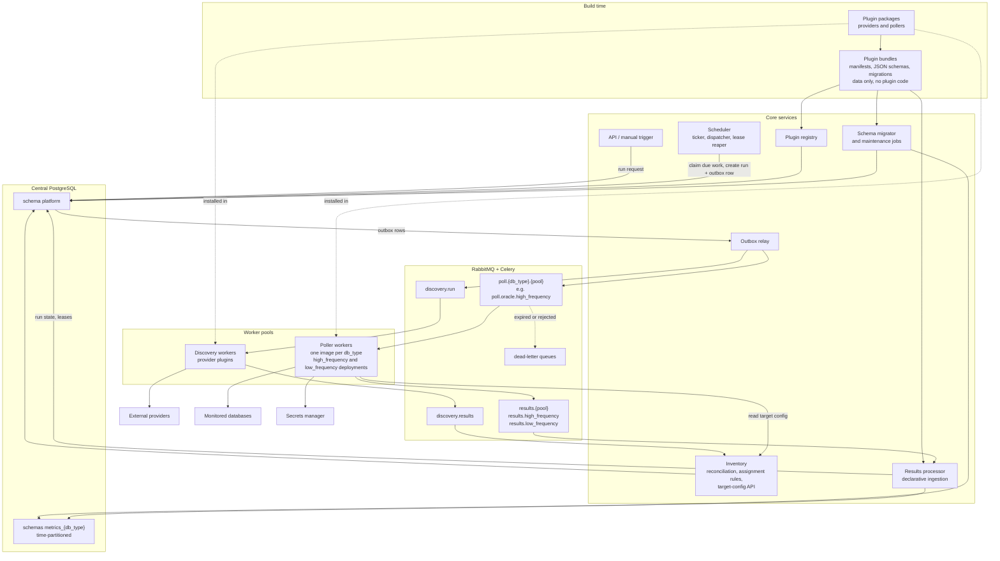
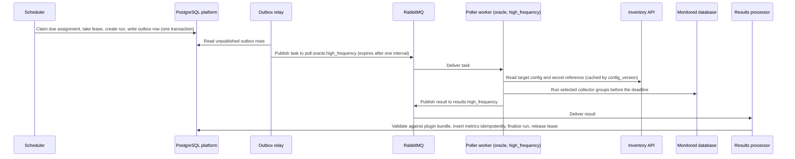

# Database Monitoring Platform — Architecture Guide

**Version 2.0 — reconciled revision.** This document supersedes the earlier draft. It resolves the inconsistencies in queue topology, worker images, persistence ownership and the results path, and it makes high-frequency and low-frequency polling a first-class design concern. Appendix A lists every change from the earlier draft; Appendix B gives a worked sizing example.

## 1. Purpose

This document describes a modular Python platform that discovers database servers from external providers and periodically collects metrics and health information from them.

The platform must support:

- Multiple discovery providers, such as cloud APIs, CMDBs and infrastructure inventory systems.
- Database pollers for Oracle, Microsoft SQL Server (MSSQL), PostgreSQL and future database types.
- Multiple polling frequencies (at minimum high-frequency health polling and low-frequency capacity and inventory polling) without coupling frequency to database type or plugin identity.
- Independent deployment and scaling of discovery workers and of poller workers per database type and per frequency.
- Periodic and manual execution through one shared execution path.
- Reliable asynchronous work delivery through a message broker.
- A stable plugin SDK so new integrations can be added without changing core services.
- Trusted, reviewed plugins packaged into immutable deployment images.
- Realistic scale: sustained sub-minute polling across hundreds to thousands of servers (see Appendix B).

## 2. Architectural principles

1. **Core services own orchestration.** Scheduling, inventory, routing, retries, persistence, leases and manual-run authorization belong to the platform, not to plugins.
2. **Plugins own integration-specific logic.** Provider plugins discover servers. Poller plugins collect data from exactly one database type.
3. **Contracts are versioned.** Every plugin implements the shared `dbmonitor-sdk` contract and a versioned schema contract.
4. **The database is the source of truth.** PostgreSQL stores inventory, schedules, run state and results. RabbitMQ transports work; it is never the authoritative state store.
5. **Workers are independently deployable.** Discovery workers and each database type's poller workers are built, scaled and released separately.
6. **Failures are isolated.** One plugin's failure must not prevent other plugins from loading or running.
7. **Adding a plugin is additive.** A new provider, database type or profile requires no change to core service code (see section 14 for exactly which images and configurations do change).
8. **Manual and scheduled execution use one path.** Both create a persisted run through the scheduler/dispatcher and are published through the same outbox, queues and worker tasks. The API never publishes to the broker directly.
9. **Frequency is configuration, not plugin identity.** Profiles define schedule, collector groups and limits. Pools define execution lanes (queues and worker deployments). The same poller serves every profile.
10. **Workers do not touch the central database.** Workers read target configuration through the Inventory API, resolve secrets through the secrets manager and return results through the broker.
11. **Core services consume plugin data, not plugin code.** The registry, results processor and schema migrator consume build-time *plugin bundles* (manifests, JSON Schemas, migrations). Only workers load plugin code.
12. **Expire rather than catch up.** A high-frequency poll that cannot start within its interval is dropped and counted, never replayed late.

## 3. Architecture overview

### 3.1 Logical diagram



The diagram is logical. Services may be combined into fewer deployables (for example the scheduler, outbox relay and lease reaper in one process with several replicas), but the data flows must be preserved.

### 3.2 Key decisions

| Topic | Decision |
|---|---|
| Routing | Queue = `poll.{db_type}.{pool}`, derived from the profile's pool. Pools are `high_frequency` and `low_frequency` by default. |
| Worker images | One image per database type, containing the worker runtime, that one poller plugin and its drivers. Each image runs as one deployment per pool. |
| Frequency model | Profiles (schedule, collector groups, limits) point to pools (queue, worker deployment). Adding a profile needs no new infrastructure if its pool exists. |
| Scheduling | A ticker in the scheduler service claims due rows from PostgreSQL with `FOR UPDATE SKIP LOCKED`. Celery Beat is not used, so there is no single-instance scheduler. |
| Reliable dispatch | A transactional outbox: run row and outbox row commit together, and an outbox relay publishes to RabbitMQ. |
| Run-state writer | The results processor is the only writer of terminal run state. Workers have no database credentials. |
| Metrics storage | Plugin-owned, time-partitioned schemas `metrics_{db_type}`, ingested declaratively from plugin bundles. There is no generic `metric_samples` table. |
| Cross-engine reporting | Every plugin must provide an `instance_health` table with common columns. A `reporting` schema unions them in views. |

### 3.3 Scheduled polling flow



### 3.4 Manual execution flow

A manual request goes to the API, which authenticates and authorizes it, validates the scope and idempotency key, and writes a `manual_run_requests` row. It returns `202 Accepted` with a run ID. The scheduler picks the request up on its next tick (within about a second) and applies exactly the same validation, leases, concurrency limits and routing as scheduled work, then writes the run and outbox rows. From that point the flow is identical to section 3.3. A manual run does not change the normal schedule unless the request explicitly asks for it.

Manual triggers never invoke plugin code in the API process.

## 4. Core concepts

| Concept | Definition |
|---|---|
| `db_type` | Validated string identifier for a database engine (`oracle`, `mssql`, `postgresql`, `mysql`). Not a closed enum. Pattern: `^[a-z][a-z0-9_]{1,31}$`. |
| Plugin | A separately versioned Python distribution. Kinds: `provider` and `poller`. A poller supports exactly one `db_type`. |
| Collector group | A named set of related collectors within a poller, from a shared vocabulary such as `health`, `sessions`, `performance`, `capacity`, `replication`. Each plugin declares the groups it supports and a minimum safe interval for each. |
| Polling profile | Persisted configuration: interval, collector groups, timeout, retry policy, concurrency, missed-interval policy and a target pool. Data only. Not tied to any plugin. |
| Polling pool | An execution lane: a queue template, a results queue and a worker deployment shape. There are few pools and changing them is an infrastructure change. Defaults: `high_frequency` and `low_frequency`. |
| Assignment | The binding of one server to one profile, with an enabled flag and optional overrides. A server may have several assignments, for example a high-frequency health profile and a low-frequency capacity profile. |
| Run | One execution of one assignment for one due slot, or one manual request. Has a stable `polling_run_id`, a status and an `attempt_count`. Retries are attempts within a run, not new runs. |
| Network zone (optional) | A routing dimension for servers that are only reachable from certain worker locations. Queue templates may include `{zone}`. Unused by default. |

## 5. Main components

### 5.1 `dbmonitor-sdk`

A small shared package defining the stable contracts used by core services and plugins.

Responsibilities:

- Plugin interfaces and manifests (provider and poller).
- Shared input and output models: `DiscoveredServer`, `DatabaseTarget`, `PollContext`, `PollResult`, `CollectorResult`.
- The standard collector-group vocabulary.
- Polling profile models and profile validation rules (including interval floors).
- The metric envelope and the schema-contract models and validators.
- Common error categories.
- Plugin bundle export (`bundle/export.py`).
- Contract-testing utilities, shipped as an optional extra (`dbmonitor-sdk[testing]`) so runtime images stay small.

The SDK contains no orchestration logic and no database persistence.

### 5.2 Discovery plugins

A discovery plugin integrates with one external provider or source and returns normalized server descriptions:

- Provider and provider resource identifier.
- Hostname, address, port and database type when known.
- Environment, region, network zone, tags and ownership metadata.
- A secret reference, never a raw credential.
- Provider-specific metadata where needed.

`discover()` returns an iterable of pages so large estates do not need to fit in memory. Discovery plugins never create or delete inventory records. Discovery workers publish normalized results to `discovery.results`, and the Inventory service consumes them. A provider package may support several configured provider instances, for example separate production and development accounts. Each instance has its own credentials reference, interval and state.

### 5.3 Inventory and reconciliation

The Inventory service translates discovery results into canonical server records. It must:

- Use stable identifiers and provider associations; provider identifiers and canonical `server_id` values are distinct concepts.
- Upsert idempotently and track `last_seen_at` per provider association.
- Handle servers discovered by several providers.
- Never delete or disable a server because one discovery run failed. Apply an explicit stale-resource policy (for example not seen for N successful runs) before retiring a server.

**Assignment rules.** Inventory also owns assignment rules in `assignment_rules`. A rule matches on `db_type`, environment, tags, provider instance or network zone and names one or more profiles. When a server is created or updated, Inventory evaluates the rules and writes `server_polling_assignments` with `source = rule`. Assignments created manually (`source = manual`) are never overwritten by rules. This replaces the manual "assign profiles" step and is what makes newly discovered servers start being polled.

**Target-config API.** Inventory serves normalized `DatabaseTarget` records, including the secret reference and a `config_version`, to workers over authenticated service-to-service calls. Access is scoped to the requesting worker's `db_type`. Workers cache by `config_version`.

### 5.4 Poller plugins

Each poller plugin supports exactly one database type. It receives a normalized target and a `PollContext`, and returns a `PollResult`.

A poller owns database-specific connection and collection logic. It does not own scheduling, queue management, inventory or metric persistence, and it never fetches secrets itself: it resolves them through `context.credentials`. It obtains connections through `context.connections` so the worker runtime can pool and reuse them. It must honor `context.deadline`.

Poller plugins declare collector groups. A profile selects groups; the plugin runs the intersection of the profile's groups and its own. An assignment whose intersection is empty is rejected when it is created.

### 5.5 Scheduler and dispatcher

The scheduler service has three cooperating loops, all safe to run with several replicas:

1. **Ticker and dispatcher.** Every tick (about 1 s) it claims due work with a query of this shape:

   ```sql
   SELECT ...
   FROM platform.polling_state
   WHERE enabled
     AND next_due_at <= now()
     AND (lease_expires_at IS NULL OR lease_expires_at < now())
   ORDER BY next_due_at
   LIMIT :batch
   FOR UPDATE SKIP LOCKED;
   ```

   For each claimed row, in one transaction, it: validates the `db_type` is registered and enabled with a pool for the profile's pool name; checks concurrency limits; sets the lease; advances `next_due_at` according to the profile's missed-interval policy; inserts the `polling_runs` row; and inserts the outbox row. Pending manual requests are processed by the same loop.
2. **Outbox relay.** Publishes unpublished outbox rows to RabbitMQ with publisher confirms, then marks them published. Duplicates are possible and harmless.
3. **Lease and run reaper.** Handles leases that expired without a terminal result, and runs that were dropped (expired tasks never emit results). It marks such runs `lost` or `expired`, releases the lease, increments missed-interval counters and applies the retry policy for low-frequency runs.

Routing uses validated identifiers only, with no per-database or per-frequency branches in code: `queue = pool.queue_template.format(db_type=..., zone=...)`. If the combination is not enabled, the run is `rejected` with a clear operational error. It is never sent to a default poller.

The same scheduler loops also trigger discovery for each provider instance (`provider_instances.next_due_at`), using the same lease and outbox pattern.

### 5.6 Worker runtime (`dbmonitor-worker-runtime`)

A shared package that provides everything a worker needs besides plugin logic:

- Celery application factory and the `poll_server` and `run_discovery` tasks.
- Plugin loading from entry points and startup validation (plugin ID, `db_type`, SDK range, supported groups and pools).
- Deadline handling and per-task timeouts.
- The Inventory target-config client with `config_version` caching.
- The credential resolver (secrets manager client with a short TTL cache).
- The connection provider (pooling and reuse, see section 7.6).
- Result building, result size enforcement and publishing.
- Structured logging and OpenTelemetry.

It has no dependency on the platform database packages. This is enforced in CI (section 16).

### 5.7 Results processor

The results processor consumes `results.{pool}` (one deployment per pool, so heavy low-frequency payloads cannot delay high-frequency results). For each message it:

1. Validates the envelope and the run (known `polling_run_id`, expected `db_type`, plugin ID and version).
2. Validates each collector's tables and rows against the JSON Schemas in the plugin bundle. Unknown tables or columns are rejected.
3. Stamps `server_id`, `polling_run_id` and `collected_at` onto every row.
4. Inserts with parameterized bulk statements using `ON CONFLICT DO NOTHING`, into the destinations declared in the bundle, within one transaction.
5. Finalizes the run (`succeeded`, `partially_succeeded` or `failed`), updates `polling_state` (`last_success_at`, `consecutive_failures`) and releases the lease.

It never imports plugin code. If a message references a schema version that has not yet been migrated, it is retried with backoff and then dead-lettered (`schema_not_ready`). Deployment order (migrate first, then roll workers) normally prevents this.

### 5.8 Schema migrator and maintenance

- **Platform schema:** Alembic migrations in `services/schema-migrator/platform_migrations/`.
- **Plugin schemas:** a plugin runner applies each bundle's forward-only SQL migrations with checksum validation, one transaction per migration, and per-namespace versions recorded in `platform.plugin_schema_versions`. Migrations follow expand/contract so old and new workers can coexist.
- **Maintenance jobs** (scheduled jobs, separate role): create future partitions ahead of time, drop expired partitions according to each table's declared retention, prune published outbox rows and old run history.

### 5.9 Manual trigger API

An authenticated administrative API:

```text
POST /discovery-runs                 POST /polling-runs
GET  /discovery-runs/{run_id}        GET  /polling-runs/{run_id}
POST /discovery-runs/{run_id}/retry  POST /polling-runs/{run_id}/retry
POST /polling-runs/{run_id}/cancel   # only runs that have not started
```

A polling run request may target one server, a set of servers, all enabled servers of a `db_type`, or servers filtered by provider, environment or zone, optionally with a specific profile. The API must provide:

- Request validation and authorization by provider, environment, `db_type`, profile and server scope.
- Idempotency keys.
- A returned run ID and `202 Accepted`; no synchronous execution.
- Status visibility: `requested`, `queued`, `running`, `succeeded`, `partially_succeeded`, `failed`, `cancelled`, `rejected`, `expired`, `lost`.
- Audit information on who or what initiated the run.
- Optional dry-run or preview for discovery.

`running` is reported through an optional lightweight `started` event from the worker. It is enabled for the low-frequency pool and for manual runs, and disabled for the high-frequency pool to avoid doubling message volume. Cancellation applies only to queued runs (the Celery task is revoked or discarded at receipt); running work is not interrupted.

### 5.10 Plugin registry and bundles

At build time the SDK exports a **plugin bundle** per plugin version containing the plugin manifest, the schema manifest, JSON Schemas for each declared table and the migration files. Bundles are data only. The registry loads them into `plugin_registry` (ID, kind, version, `db_type`, groups, interval floors, schema version, enabled pools, enabled flag). Enabling a plugin and its pools is an explicit administrative action. The results processor and schema migrator images embed the bundles of all enabled plugins.

Workers announce their plugin ID and version to the registry at startup. The registry flags drift from the expected version.

## 6. Plugin contracts and discovery

Plugins are discovered through Python entry points, with no hard-coded list in core.

Provider example:

```toml
[project]
name = "dbmonitor-provider-cmdb"
version = "1.0.0"
dependencies = ["dbmonitor-sdk>=1.0,<2.0", "httpx>=0.27"]

[project.entry-points."dbmonitor.providers"]
cmdb = "dbmonitor_provider_cmdb.plugin:plugin"
```

Poller example (the entry-point name must equal the plugin's `db_type`; the plugin ID is `dbmonitor-poller-postgresql`):

```toml
[project]
name = "dbmonitor-poller-postgresql"
version = "1.0.0"
dependencies = ["dbmonitor-sdk>=1.0,<2.0", "psycopg>=3.2"]

[project.entry-points."dbmonitor.pollers"]
postgresql = "dbmonitor_poller_postgresql.plugin:plugin"
```

Simplified contract (the real models are Pydantic):

```python
from typing import Protocol, Iterable, Sequence

class DiscoveryPlugin(Protocol):
    plugin_id: str
    def discover(self, context: "DiscoveryContext") -> Iterable[list["DiscoveredServer"]]: ...

class PollContext(Protocol):
    run_id: str
    attempt: int
    profile: str                      # e.g. "high_frequency"
    collector_groups: Sequence[str]   # groups to run, already intersected with the plugin's groups
    deadline: "datetime"              # absolute; collectors must stop before this
    connections: "ConnectionProvider"
    credentials: "CredentialResolver"

class PollerPlugin(Protocol):
    plugin_id: str
    db_type: str                      # exactly one database type per poller
    def poll(self, target: "DatabaseTarget", context: PollContext) -> "PollResult": ...

class CollectorResult(BaseModel):
    group: str
    status: Literal["ok", "failed", "skipped", "timeout"]
    error_category: str | None = None
    truncated: bool = False
    tables: dict[str, list[dict]] = {}   # table name (declared in schema manifest) -> rows

class PollResult(BaseModel):
    collected_at: datetime
    collectors: list[CollectorResult]    # overall status is derived from these
```

Rows carry only engine-specific columns. The worker runtime and processor add the envelope fields.

### Plugin manifest

Each plugin declares at least:

```yaml
plugin_id: dbmonitor-poller-oracle
kind: poller
version: 1.0.0
sdk_range: ">=1.0,<2.0"
db_type: oracle
config_schema: config.py:OracleConfig
collector_groups:
  health:      { min_interval_seconds: 30,  default_timeout_seconds: 15 }
  sessions:    { min_interval_seconds: 30,  default_timeout_seconds: 15 }
  performance: { min_interval_seconds: 300, default_timeout_seconds: 60 }
  capacity:    { min_interval_seconds: 600, default_timeout_seconds: 120 }
```

The manifest also declares capabilities and health-check information where applicable. Interval floors are enforced by the platform: no profile or assignment may schedule a collector group more often than its declared floor.

### Loading rules

- Discover plugins from installed entry points; validate manifests and SDK compatibility at startup.
- Report an invalid plugin without preventing unrelated plugins from loading.
- Never install packages at runtime; pin dependencies and deploy immutable images.
- Register and enable plugins explicitly through the registry.
- Reject unknown `db_type` values; do not route them to a default poller.

Entry points are a discovery mechanism, not a sandbox. Plugins run with the permissions of their worker process, which is why plugin code must be trusted and reviewed.

## 7. Polling profiles, pools and high/low frequency

### 7.1 Three separate concepts

Earlier drafts mixed frequency, queue and worker image. This revision separates them:

| Concept | What it is | How many | Changing it requires |
|---|---|---|---|
| **Pool** | Execution lane: queue template, results queue, worker deployment shape | Few (default 2) | Infrastructure change (queue, deployment), no code |
| **Profile** | Schedule and policy: interval, collector groups, timeout, retries, limits, target pool | Many | Data change only |
| **Assignment** | Binds a server to a profile | One or more per server | Data change only |

A profile never names a queue. It names a pool, and the queue is derived: `poll.{db_type}.{pool}`. Adding a profile that uses an existing pool needs no new queue and no new worker deployment.

### 7.2 Default pools and profiles

```yaml
polling_pools:
  high_frequency:
    queue_template: "poll.{db_type}.high_frequency"
    results_queue:  "results.high_frequency"
    expiry_factor: 1.0          # drop polls that cannot start within 1 x interval
  low_frequency:
    queue_template: "poll.{db_type}.low_frequency"
    results_queue:  "results.low_frequency"
    expiry_factor: 1.0

polling_profiles:
  high_frequency:
    pool: high_frequency
    interval_seconds: 60        # 30 is allowed only if every selected group's floor permits it
    collector_groups: [health, sessions, replication]
    timeout_seconds: 20
    retry: { max_attempts: 1 }  # the next poll is already coming; retries would create overlap
    max_concurrency_per_server: 1
    missed_interval_policy: skip
    freshness_slo_seconds: 150  # alert if last_success_at is older than this
  low_frequency:
    pool: low_frequency
    interval_seconds: 900
    collector_groups: [performance, capacity]
    timeout_seconds: 120
    retry: { max_attempts: 3, backoff: exponential, jitter: true }
    max_concurrency_per_server: 1
    missed_interval_policy: run_once
    freshness_slo_seconds: 2700
```

Profiles may be added (for example `capacity_daily` using the `low_frequency` pool) without any infrastructure change.

### 7.3 Typical collector-group split

High-frequency polling is cheap, narrow and latency-sensitive. Low-frequency polling is heavier and tolerates delay.

| Engine | High-frequency groups | Low-frequency groups |
|---|---|---|
| Oracle | `health` (instance and database status), `sessions` (active session counts) | `performance`, `capacity` (tablespace usage) |
| MSSQL | `health`, `sessions` | `performance`, `capacity` (database file sizes) |
| PostgreSQL | `health`, `sessions` (connections), `replication` (lag) | `performance` (table and index statistics), `capacity` |

This is a default recommendation. Each plugin ships a `profiles.example.yaml` with its suggested split, and operators adjust profiles as data.

### 7.4 Routing rule

```text
queue = pool.queue_template.format(db_type=<assignment.db_type>, zone=<server.network_zone>)
```

The scheduler publishes only if the registry says that `db_type` has that pool enabled. A `db_type` may legitimately run only one pool (for example only `low_frequency` for a rarely polled engine). Unknown combinations are `rejected`. Workers also validate on receipt that the task's `db_type` and pool match their own configuration and reject mismatches to the dead-letter queue.

### 7.5 Scheduling semantics

- **Fixed-rate scheduling.** `next_due_at` advances by one interval from the previous due time, not from completion time, so latency does not cause drift.
- **`skip` (high-frequency).** If the scheduler or workers fall behind, missed slots are skipped and counted. The next due time is `max(previous_due + interval, now)`. There is never a catch-up burst.
- **`run_once` (low-frequency).** After an outage, one poll runs promptly and the schedule resumes. It is not replayed once per missed slot.
- **Task expiry.** Every poll task carries `expires = interval x expiry_factor`. A worker that receives an expired task discards it. The reaper then marks the run `expired`. Stale data is never produced late.
- **Jitter.** Initial `next_due_at` values are spread across the interval so thousands of servers do not align on the same second.

### 7.6 Safety limits and load control

Monitoring must not harm the monitored database.

- **Interval floors:** each collector group declares `min_interval_seconds` in the plugin manifest. A platform-wide floor (default 30 s) applies on top. Assignments below either floor are rejected.
- **Per-assignment lease:** no overlapping runs of the same assignment.
- **Per-server cap:** at most N concurrent runs across all assignments of a server (default 2).
- **Concurrency groups:** servers may share a group (for example the same host or a multi-tenant instance), and the claim query caps active leases per group.
- **Connection reuse:** the worker runtime's connection provider keeps a cached connection per target with an idle TTL for the high-frequency pool, avoiding a fresh login every 30 to 60 seconds (login storms, audit noise, slow handshakes). The low-frequency pool may open a connection per run. High-frequency workers should use a thread or gevent pool where the driver supports it, so connections persist across tasks. Otherwise use prefork with a per-process cache.
- **Secret caching:** credentials are cached for a short TTL (default 5 minutes) so the secrets manager is not called on every poll.
- **Bounded output:** collectors return aggregates or top-N rows, with a per-result size cap (section 8.4).
- **Backpressure:** task expiry is the primary mechanism. Optionally the scheduler also skips enqueueing when the oldest message in a pool's queue exceeds a threshold, using cached broker statistics.

### 7.7 Worker settings by pool

| Setting | `high_frequency` | `low_frequency` |
|---|---|---|
| Celery pool | threads or gevent (persistent connections) | prefork (isolation for heavy queries) |
| Prefetch multiplier | 1 | 1 |
| Acknowledgement | late | late |
| Task timeout | 20 s | 120 s |
| Retries | none | exponential backoff with jitter |
| Connections | cached per target, idle TTL 300 s | per run |
| `started` events | off | on |
| Scaling signal | oldest message age in queue | queue depth |
| Capacity | reserved, never shared with low-frequency | scaled independently |

### 7.8 Freshness as a service-level objective

Define freshness per profile (`freshness_slo_seconds`, section 7.2). The platform computes staleness per server and profile from `polling_state.last_success_at` and alerts when it is exceeded. End-to-end freshness includes queue wait, execution time and results processing, so a 20 s timeout on a 30 s interval leaves very little margin. This is why the recommended default for high-frequency is 60 s, and 30 s is reserved for measured, low-impact collectors.

### 7.9 What changes when you add something

| You add | Infrastructure change | Code change |
|---|---|---|
| A profile on an existing pool | None | None |
| A new pool (for example `medium_frequency`) | Queue template, results queue, worker deployment per `db_type`, results-processor deployment | None |
| A new database type | One poller image and its two worker deployments, queues, bundle in processor and migrator images | New plugin only |

## 8. Messaging and reliability

### 8.1 Stack

RabbitMQ is the broker and Celery the worker framework. Recommended Celery settings: `task_acks_late = True`, `task_reject_on_worker_lost = True`, `worker_prefetch_multiplier = 1`, `task_ignore_result = True` (there is no Celery result backend; PostgreSQL holds all state). Use quorum queues for durability and publisher confirms for the relay. Verify any TTL or priority feature you rely on against your RabbitMQ version.

### 8.2 Queues

| Queue | Producer | Consumer | Purpose |
|---|---|---|---|
| `discovery.run` | Outbox relay | Discovery workers | Discovery tasks |
| `discovery.results` | Discovery workers | Inventory | Normalized discovery output |
| `poll.{db_type}.{pool}` | Outbox relay | Poller workers of that `db_type` and pool | Poll tasks |
| `results.{pool}` | Poller workers | Results processor of that pool | Poll results (and optional `started` events) |
| `dlq.<original queue>` | Broker (dead-letter exchange) | Reaper and operators | Rejected, exhausted or malformed messages |

Examples: `poll.oracle.high_frequency`, `poll.postgresql.low_frequency`, `results.high_frequency`.

Manual and scheduled work share these queues. Separate priority lanes for manual runs are deferred.

### 8.3 Poll task payload

Keep task messages small and identifier-based. Do not embed credentials or large configuration.

```json
{
  "message_id": "5f0f4b0e-...",
  "polling_run_id": "0c6b8f6a-...",
  "server_id": "b3a1c2d4-...",
  "db_type": "oracle",
  "profile": "high_frequency",
  "pool": "high_frequency",
  "collector_groups": ["health", "sessions"],
  "config_version": 17,
  "attempt": 1,
  "scheduled_for": "2026-10-26T12:00:30Z",
  "expires_at": "2026-10-26T12:01:30Z",
  "trigger": "scheduled",
  "requested_by": null
}
```

### 8.4 Result message

One result message is sent per run outcome. Its size is capped (`max_result_bytes`, default 1 MiB), enforced in the worker runtime. Collectors must bound their output; when a collector truncates, it sets `truncated = true`. A claim-check pattern for oversized payloads is deferred until measurements show a need.

```json
{
  "message_id": "9d1e...",
  "polling_run_id": "0c6b8f6a-...",
  "server_id": "b3a1c2d4-...",
  "db_type": "oracle",
  "plugin_id": "dbmonitor-poller-oracle",
  "plugin_version": "1.0.0",
  "schema_version": "0003",
  "profile": "high_frequency",
  "pool": "high_frequency",
  "attempt_count": 1,
  "collected_at": "2026-10-26T12:00:31Z",
  "started_at": "2026-10-26T12:00:30Z",
  "finished_at": "2026-10-26T12:00:33Z",
  "status": "partially_succeeded",
  "collectors": [
    { "group": "health", "status": "ok",
      "tables": { "instance_health": [ { "is_available": true, "response_time_ms": 41 } ] } },
    { "group": "sessions", "status": "timeout", "error_category": "query_timeout", "tables": {} }
  ]
}
```

### 8.5 Reliability rules

- **Transactional outbox.** The run row and outbox row are written in one transaction. A crash between "decide to run" and "publish" cannot lose or half-create work.
- **Leases.** The scheduler sets `lease_expires_at` when claiming. Choose the lease length as task expiry plus timeout plus a margin. The reaper recovers expired leases, so a crash can never strand an assignment.
- **Idempotent persistence.** Metric rows carry `polling_run_id` and `collected_at`, and the idempotency key `(polling_run_id, collected_at, <natural key>)` is a unique index, so redelivery with `ON CONFLICT DO NOTHING` is harmless. At-least-once delivery is assumed everywhere.
- **Retries.** Retries happen inside a run (Celery retry with backoff) only for transient errors and only while `expires_at` has not passed. Permanent errors (authentication, unknown plugin, invalid configuration) fail fast. Only the final outcome produces a result message; intermediate failures are logged and counted.
- **Dead letters.** Messages that are rejected, malformed, or exhausted go to `dlq.*`. The reaper reconciles them into run status.
- **Expired tasks** that workers discard produce no result. The reaper marks those runs `expired`.
- **Run-state ownership.** Only the scheduler (creation, `queued`, `rejected`, `cancelled`, `expired`, `lost`) and the results processor (terminal outcomes) write run state. Workers never do.
- **Schema readiness.** A result referencing a schema version that is not yet applied is retried and then dead-lettered as `schema_not_ready`.

## 9. Worker deployment model

### 9.1 Deployment units

| Unit | Image | Notes |
|---|---|---|
| API | `Dockerfile.api` | Includes registry client. Two or more replicas. |
| Scheduler | `Dockerfile.scheduler` | Ticker, dispatcher, reaper, relay. Two or more replicas, safe by design. |
| Inventory | `Dockerfile.inventory` | Reconciliation, rules, target-config API. |
| Plugin registry | `Dockerfile.plugin-registry` | May be merged into the API. |
| Discovery worker | `Dockerfile.discovery-worker` | All provider plugins. |
| Poller worker | `Dockerfile.poller-worker` with `ARG PLUGIN=<db_type>` | One image per database type. One deployment per pool. |
| Results processor | `Dockerfile.results-processor` | One deployment per pool. Embeds plugin bundles. |
| Schema migrator | `Dockerfile.schema-migrator` | Job. Embeds plugin bundles. |
| Maintenance | `Dockerfile.maintenance` | Scheduled jobs. |

Poller images are produced from one parameterized Dockerfile. Each poller package contributes its OS dependencies (for example the ODBC driver for MSSQL) through `image/system-deps.txt`. This avoids a hand-maintained Dockerfile per database.

### 9.2 One image, two deployments

For every database type there is one image and two worker configurations:

```yaml
# deploy/workers/oracle/high_frequency.yaml
plugin_id: dbmonitor-poller-oracle
db_type: oracle
pool: high_frequency
queues: ["poll.oracle.high_frequency"]
celery:
  pool: threads
  concurrency: 16
  prefetch_multiplier: 1
  acks_late: true
limits:
  task_timeout_seconds: 20
  max_result_bytes: 1048576
connections:
  cache: persistent
  idle_ttl_seconds: 300
  max_per_target: 1
secrets:
  cache_ttl_seconds: 300
resources:
  cpu: "1"
  memory: 1Gi
autoscaling:
  signal: oldest_message_age_seconds
  target: 10
```

```yaml
# deploy/workers/oracle/low_frequency.yaml
plugin_id: dbmonitor-poller-oracle
db_type: oracle
pool: low_frequency
queues: ["poll.oracle.low_frequency"]
celery:
  pool: prefork
  concurrency: 8
  prefetch_multiplier: 1
  acks_late: true
limits:
  task_timeout_seconds: 120
  max_result_bytes: 1048576
connections:
  cache: per_task
secrets:
  cache_ttl_seconds: 300
resources:
  cpu: "2"
  memory: 2Gi
autoscaling:
  signal: queue_depth
  target: 20
```

Kubernetes deployments are generated from one Helm chart and these value files, so the number of manifests does not grow as database types times pools.

### 9.3 Startup validation

A poller worker must, at startup:

- Load exactly the plugin named in its configuration and verify its `db_type`, SDK range and manifest.
- Verify that the configured queues match `poll.{db_type}.{pool}`.
- Refuse to start on mismatch, with a clear error and metric.

Because each image contains one poller and one `db_type`'s credentials are only available to that deployment, a compromise or dependency conflict in one engine's plugin does not affect others.

### 9.4 Optional network zones

If monitored servers are reachable only from certain networks, give servers a `network_zone`, include `{zone}` in the queue template (for example `poll.{zone}.{db_type}.{pool}`) and deploy workers per zone. Without zones, leave the template as is.

## 10. Persistence model

### 10.1 Schemas and roles

PostgreSQL holds three kinds of schemas:

- `platform`: inventory, configuration, schedules, run state, outbox, audit.
- `metrics_{db_type}`: plugin-owned metric tables (one schema per plugin).
- `reporting`: views that unify plugin tables for cross-engine queries (for example all `instance_health` tables).

| Role | Privileges |
|---|---|
| `migrator` | DDL on `platform` and `metrics_*` |
| `platform_app` | DML on `platform` (API, scheduler, inventory, registry) |
| `ingest` | `INSERT` only on `metrics_*`; limited `UPDATE` on run and state tables (results processor) |
| `maintenance` | Create and drop partitions, prune platform history |
| `reporting_ro` | `SELECT` on `reporting` and `metrics_*` |

Workers have no database role.

### 10.2 Platform tables

| Table | Purpose |
|---|---|
| `database_servers` | Canonical server records (`server_id` UUID, `db_type`, address, environment, tags, `network_zone`, status, `config_version`) |
| `provider_instances` | Configured provider instances: credentials reference, discovery interval, `next_due_at`, lease, enabled |
| `provider_associations` | Server to provider-resource mapping, `last_seen_at` |
| `discovery_runs` | Discovery run history and status |
| `polling_pools` | Pool definitions (queue template, results queue, expiry factor) |
| `polling_profiles` | Profile definitions (pool, interval, groups, timeout, retry, concurrency, SLO) |
| `assignment_rules` | Rules that create assignments for matching servers |
| `server_polling_assignments` | Server to profile bindings, `source` (`rule` or `manual`), overrides, enabled |
| `polling_state` | Hot scheduling state per assignment: `next_due_at`, lease owner and expiry, `last_run_id`, `last_success_at`, `consecutive_failures` |
| `polling_runs` | One row per run, with `attempt_count`, status, trigger, timestamps, error category. Partitioned by `created_at`. |
| `manual_run_requests` | Persisted manual requests with idempotency key and requester |
| `outbox` | Unpublished and recently published messages |
| `plugin_registry` | Registered plugins, versions, groups, floors, enabled pools |
| `plugin_schema_versions` | Applied migration version per plugin namespace |
| `audit_log` | Administrative and manual actions |

There is no generic `metric_samples` table. The earlier draft's `polling_attempts` concept is dropped: a run carries `attempt_count`, which is enough until attempt-level history is shown to be needed.

`polling_state` is updated at the polling rate of every assignment, so create it with a reduced `fillfactor` (for example 70) and avoid indexes on frequently updated columns other than the due-time index, to keep updates heap-only and bloat low.

### 10.3 Run states

```text
requested -> queued -> running -> succeeded | partially_succeeded | failed
requested -> rejected
queued    -> cancelled | expired | lost
running   -> lost
```

### 10.4 Metric tables

Rules for every plugin table (enforced by CI against the schema manifest):

- Lives in the plugin's own schema, named `metrics_{db_type}`.
- Contains `server_id UUID NOT NULL`, `polling_run_id UUID NOT NULL`, `collected_at TIMESTAMPTZ NOT NULL`.
- Is **range-partitioned on `collected_at`** and declares its partition interval and retention.
- Has a primary or unique key that includes `collected_at` (a PostgreSQL requirement for partitioned tables) and `polling_run_id`, so redelivery is idempotent.
- Has an index on `(server_id, collected_at DESC)`.
- Uses explicit units in column names (`_bytes`, `_ms`, `_percent`).
- Has **no foreign keys to `platform` tables.** `server_id` and `polling_run_id` are correlation identifiers validated by the results processor at ingestion. This keeps partition drops cheap, avoids cross-schema `REFERENCES` grants and keeps the option of moving metrics to a time-series store later. Foreign keys between tables inside the same plugin schema are allowed.
- Run history (`polling_runs`) may be retained for a shorter period than metrics, so `polling_run_id` can legitimately point to a pruned row.

Example:

```sql
CREATE TABLE metrics_postgresql.instance_health (
    server_id        UUID        NOT NULL,
    polling_run_id   UUID        NOT NULL,
    collected_at     TIMESTAMPTZ NOT NULL,
    is_available     BOOLEAN     NOT NULL,
    response_time_ms INTEGER,
    PRIMARY KEY (polling_run_id, collected_at)
) PARTITION BY RANGE (collected_at);

CREATE INDEX ON metrics_postgresql.instance_health (server_id, collected_at DESC);
```

### 10.5 Retention and partitioning

Partitioning and retention are part of the schema contract from day one, not a later optimization. At sustained high-frequency polling, `DELETE`-based retention causes table bloat and long vacuums (see Appendix B). The maintenance service creates partitions ahead of time and drops expired ones. Typical starting retention: 7 to 14 days for high-frequency tables, 90 to 400 days for low-frequency tables. Retention applies to every metric table, to `polling_runs` (for example 30 days) and to the `outbox`.

## 11. Plugin schema contract

### 11.1 Schema manifest

Every poller plugin ships `schema/manifest.yaml`:

```yaml
plugin_id: dbmonitor-poller-postgresql
db_type: postgresql
schema: metrics_postgresql
schema_version: "0003"
tables:
  instance_health:
    required: true             # mandatory common table
    partition: { column: collected_at, interval: day }
    retention_days: 14
    columns:
      is_available:     { type: boolean, nullable: false }
      response_time_ms: { type: integer, unit: ms }
  connections:
    partition: { column: collected_at, interval: day }
    retention_days: 14
    columns:
      active_connections: { type: integer }
      max_connections:    { type: integer }
  table_statistics:
    partition: { column: collected_at, interval: week }
    retention_days: 90
    columns:
      schema_name:   { type: text, nullable: false }
      table_name:    { type: text, nullable: false }
      size_bytes:    { type: bigint, unit: bytes }
```

The plugin manifest (section 6) and the schema manifest are separate files. The plugin manifest describes what the plugin collects and its limits; the schema manifest describes where results are stored.

### 11.2 Required common table

Every poller must provide `instance_health` with at least `server_id`, `polling_run_id`, `collected_at`, `is_available` and `response_time_ms`. The `reporting` schema unions these tables so cross-engine availability and latency reporting needs no generic metric table.

### 11.3 Declarative ingestion

The SDK exports the schema manifest as JSON Schemas and parameterized insert definitions into the plugin bundle. The results processor uses only these definitions. It does not load plugin code and holds no plugin-specific logic. Consequences:

- Adding a poller does not change processor code. It does require that the processor image (and the migrator image) be rebuilt with the new bundle, or be configured to read bundles from a versioned artifact store.
- Plugin code never runs with ingest privileges.
- A plugin cannot write to tables it did not declare.

### 11.4 Migrations

- Forward-only SQL files, ordered and checksummed, under `schema/migrations/`.
- Expand/contract discipline: add before use, remove only after no deployed version needs it.
- A plugin may migrate only its own schema, never `platform` tables.
- Deployment order is always: apply migrations, then roll processors, then roll workers.
- Migrations that must work on partitioned tables declare how new partitions inherit them.

## 12. Observability

Use structured logs, metrics and traces with correlation IDs (`polling_run_id`, `server_id`, `message_id`) across API, scheduler, broker, worker and processor.

**Scheduling and freshness**
- Staleness per server and profile versus `freshness_slo_seconds`.
- Due-to-published latency (scheduler lag) and published-to-started latency (queue wait), per pool.
- Runs by status per pool and `db_type`: `expired`, `lost`, `rejected` and skipped-interval counts.
- Lease reaper actions, outbox lag and unpublished outbox size.

**Queues and workers**
- Queue depth and oldest message age per queue.
- Dead-letter queue depth, with alerts on any growth.
- Worker utilization, task duration and timeouts per `db_type` and pool.
- Connection cache hit rate, secret cache hit rate and secrets-manager error rate.

**Plugins and ingestion**
- Plugin load failures, version drift and startup validation failures.
- Collector status and error category per group.
- Results processed per second, validation rejections, `schema_not_ready` count, insert latency, rows per message and truncation count.
- Partition headroom (days of future partitions), retention job duration and table sizes.

**Discovery**
- Duration, record counts, provider errors and stale-resource counts per provider instance.

## 13. Security and failure handling

### 13.1 Security

- Authenticate and authorize every manual trigger; log who or what initiated each run.
- Store only secret references in the database and in messages. Resolve secrets in the worker, cache them with a short TTL, and never log them.
- Grant each worker deployment only the secrets and network access its `db_type` needs. This is why poller images are one per database type and not shared multi-plugin pools.
- Give monitoring accounts on monitored databases the minimum read-only privileges.
- Authenticate service-to-service calls (workers to Inventory and registry) and scope target-config access to the worker's `db_type`.
- Treat plugins as trusted code. Review, pin and scan their dependencies, and deploy only immutable images.
- Use least-privilege database roles (section 10.1). Workers have none.
- Validate all plugin output against the bundle's schemas before insertion.

### 13.2 Failure handling

| Failure | Behavior |
|---|---|
| Plugin fails to load | Worker refuses to start with a clear error. Other deployments are unaffected. |
| Unknown or disabled `db_type` or pool | Run is `rejected`. Never routed to a default poller. |
| Monitored database unreachable | Run fails with a categorized error. `consecutive_failures` increments. High-frequency polls are not retried. |
| Worker crash or loss | Late acknowledgement redelivers the task if it is still unexpired. Otherwise the reaper marks it `lost` or `expired`. |
| Scheduler crash between claim and publish | Impossible to strand: run and outbox row commit atomically, and the reaper recovers expired leases. |
| Broker outage | Outbox rows accumulate and drain on recovery. Stale high-frequency tasks expire rather than replay. |
| Duplicate result | Harmless. The unique index plus `ON CONFLICT DO NOTHING` makes ingestion idempotent. |
| Invalid plugin output | Rejected by schema validation, run marked `failed` or `partially_succeeded`, no partial garbage inserted. |
| Discovery run fails | Inventory is not changed, and no server is retired because of a failed run. |
| Schema ahead of database | `schema_not_ready` retries, then dead-letters. Deployment order prevents it normally. |

## 14. Extending the platform

### 14.1 Add a discovery provider

1. Create `plugins/providers/<name>/` from the scaffold (`tools/new_plugin_scaffold/`).
2. Implement `DiscoveryPlugin`, a configuration model and a manifest.
3. Run the SDK provider contract tests.
4. Rebuild the discovery worker image and release it.
5. Register the plugin, then create one or more `provider_instances`.

No core code changes and no new queues.

### 14.2 Add a database type

1. Create `plugins/pollers/<db_type>/` from the scaffold: poller, collector groups, manifest, schema manifest and migrations, `profiles.example.yaml`, `image/system-deps.txt`.
2. Run the SDK poller, profile and schema contract tests.
3. Build the plugin bundle (`tools/export_plugin_bundles.py`).
4. Add `deploy/workers/<db_type>/high_frequency.yaml` and `low_frequency.yaml` (only the pools you need).
5. Regenerate the RabbitMQ topology (`tools/generate_rabbitmq_topology.py`) so the queues and dead-letter queues exist.
6. Rebuild the results-processor and schema-migrator images (they embed the new bundle), apply migrations, then roll the processor and the new worker image.
7. Register and enable the plugin and its pools; add or adjust assignment rules.

No change to the scheduler, API or any existing plugin.

### 14.3 Add a polling profile

Insert a `polling_profiles` row that names an existing pool, validate against interval floors, and add or adjust assignment rules. No deployment.

### 14.4 Add a pool

Add a pool definition, regenerate the topology, deploy the worker configuration for each `db_type` that needs it, and deploy a results-processor instance for the new results queue. No code change.

## 15. Testing and CI gates

### 15.1 Test layers

- **Unit tests** in each package and plugin.
- **SDK contract tests** (`dbmonitor_sdk.testing`) run against every plugin: provider, poller, profile and schema contracts.
- **Integration tests** with real PostgreSQL and RabbitMQ: outbox relay, leases, reaper, idempotent ingestion, schema-not-ready.
- **Monitored-database tests** with containers per engine, using fixture databases.
- **End-to-end tests:** discovery to inventory to assignment to poll to ingestion, for scheduled and manual paths.
- **Failure tests:** scheduler crash between claim and publish, worker loss mid-task, duplicate delivery, broker outage, expired tasks, schema ahead of database.
- **Load and soak tests:** sustained high-frequency polling at target scale; fairness (a saturated low-frequency pool must not delay high-frequency freshness); partition and retention behavior over days of synthetic data.

### 15.2 Required CI gates for every plugin

1. Manifest validates and the SDK range is satisfied.
2. Entry point loads in a clean environment.
3. Interface contract tests pass.
4. Every collector group is declared with a floor, and the example profiles respect the floors.
5. Schema manifest validates: partitioning declared, retention declared, `collected_at` in the key, standard columns present, units in names.
6. `instance_health` exists with the required columns.
7. No foreign keys to `platform` tables and no writes outside the plugin schema.
8. Migrations are forward-only, ordered, checksummed and apply cleanly on an empty database and on the previous version.
9. Plugin bundle exports successfully and the bundle validates against the SDK.
10. Output sizes stay within `max_result_bytes` on fixture data.
11. Dependencies are scanned and pinned.
12. Import boundaries hold (see section 16).

## 16. Repository layout

A monorepo with strict dependency boundaries.

```text
dbmonitor/
├── packages/
│   ├── dbmonitor-sdk/                    # stable contracts, no orchestration
│   │   ├── pyproject.toml
│   │   └── src/dbmonitor_sdk/
│   │       ├── contracts/                # discovery.py, poller.py, manifest.py, schema.py
│   │       ├── models/                   # server.py, target.py, results.py, profile.py
│   │       ├── groups.py                 # standard collector-group vocabulary
│   │       ├── validation/               # metric_envelope.py, schema_contract.py, profile_rules.py
│   │       ├── bundle/                   # export.py (plugin bundle builder)
│   │       ├── errors.py
│   │       └── testing/                  # provider_contract.py, poller_contract.py,
│   │                                     # profile_contract.py, schema_contract.py   (extra: [testing])
│   ├── dbmonitor-worker-runtime/         # everything a worker needs except plugin logic
│   │   └── src/dbmonitor_worker_runtime/
│   │       ├── app.py                    # Celery app factory
│   │       ├── loader.py                 # entry-point loading and startup validation
│   │       ├── tasks/                    # poll.py, discovery.py
│   │       ├── targets.py                # Inventory target-config client with caching
│   │       ├── credentials.py            # secrets resolver with TTL cache
│   │       ├── connections.py            # pooled connection provider
│   │       ├── results.py                # result building, size cap, publishing
│   │       ├── limits.py                 # deadlines and timeouts
│   │       └── telemetry.py
│   ├── dbmonitor-platform-db/            # SQLAlchemy models, outbox helpers (services only)
│   │   └── src/dbmonitor_platform_db/    # models/, repositories/, outbox.py
│   └── dbmonitor-common/                 # settings, logging, tracing, identifiers
│       └── src/dbmonitor_common/
│
├── services/
│   ├── api/                              # manual trigger API, admin API
│   ├── plugin-registry/                  # bundle loader, enabled plugins and pools
│   ├── scheduler/
│   │   └── src/dbmonitor_scheduler/      # ticker.py, polling.py, discovery.py,
│   │                                     # reaper.py, outbox_relay.py, concurrency.py
│   ├── inventory/
│   │   └── src/dbmonitor_inventory/      # reconciliation.py, rules.py, target_api.py, consumers.py
│   ├── results-processor/
│   │   └── src/dbmonitor_results/        # consumers.py, bundle_loader.py, ingest.py, finalize.py
│   ├── schema-migrator/
│   │   ├── platform_migrations/          # Alembic, platform schema only
│   │   └── plugin_runner/                # applies plugin bundle migrations
│   └── maintenance/
│       └── src/dbmonitor_maintenance/    # partitions.py, retention.py, outbox_pruning.py
│
├── plugins/
│   ├── providers/
│   │   └── cmdb/
│   │       ├── pyproject.toml
│   │       ├── src/dbmonitor_provider_cmdb/   # plugin.py, manifest.py, config.py, client.py, mapper.py
│   │       └── tests/
│   └── pollers/
│       ├── oracle/
│       │   ├── pyproject.toml
│       │   ├── src/dbmonitor_poller_oracle/
│       │   │   ├── plugin.py
│       │   │   ├── manifest.py                # collector groups and interval floors
│       │   │   ├── config.py
│       │   │   ├── connection.py
│       │   │   ├── mapper.py                  # raw rows -> declared table rows
│       │   │   ├── collectors/                # health.py, sessions.py, performance.py, capacity.py
│       │   │   ├── sql/                       # one directory per collector group
│       │   │   └── schema/
│       │   │       ├── manifest.yaml          # schema contract
│       │   │       └── migrations/            # 0001_initial.sql, ...
│       │   ├── profiles.example.yaml          # suggested high/low split for this engine
│       │   ├── image/system-deps.txt          # OS packages for the poller image
│       │   └── tests/                         # unit, contract, test_profiles.py
│       ├── mssql/                             # same structure
│       └── postgresql/                        # same structure
│
├── deploy/
│   ├── docker/
│   │   ├── Dockerfile.api
│   │   ├── Dockerfile.scheduler
│   │   ├── Dockerfile.inventory
│   │   ├── Dockerfile.plugin-registry
│   │   ├── Dockerfile.discovery-worker
│   │   ├── Dockerfile.poller-worker           # ARG PLUGIN=<db_type>, one image per database type
│   │   ├── Dockerfile.results-processor
│   │   ├── Dockerfile.schema-migrator
│   │   └── Dockerfile.maintenance
│   ├── pools/
│   │   ├── pools.yaml                         # high_frequency, low_frequency
│   │   ├── profiles.default.yaml
│   │   └── assignment-rules.example.yaml
│   ├── workers/
│   │   ├── oracle/        { high_frequency.yaml, low_frequency.yaml }
│   │   ├── mssql/         { high_frequency.yaml, low_frequency.yaml }
│   │   └── postgresql/    { high_frequency.yaml, low_frequency.yaml }
│   ├── rabbitmq/
│   │   └── topology.generated.json            # generated, do not edit by hand
│   ├── compose/
│   └── kubernetes/
│       ├── charts/                            # poller-worker, results-processor, core
│       └── overlays/                          # per environment
│
├── tools/
│   ├── export_plugin_bundles.py               # builds build/plugin-bundles/<plugin>/<version>/
│   ├── generate_rabbitmq_topology.py          # queues and DLQs from pools and enabled db_types
│   ├── check_import_boundaries.py             # CI: dependency rules below
│   └── new_plugin_scaffold/                   # provider and poller templates
│
├── tests/
│   ├── integration/
│   ├── end_to_end/
│   ├── failure/                               # crash, duplicate, outage, expiry scenarios
│   ├── load/                                  # soak and fairness tests
│   └── schema_contract/
│
├── build/                                     # generated, gitignored: plugin-bundles/
├── docs/
│   ├── architecture.md                        # this document
│   ├── plugin-development.md
│   ├── schema-contract.md
│   ├── profiles-and-pools.md
│   ├── operations.md
│   └── adr/                                   # architecture decision records
└── pyproject.toml
```

### Dependency rules (enforced in CI by `check_import_boundaries.py`)

- Plugins depend on `dbmonitor-sdk` and their own drivers only.
- `dbmonitor-worker-runtime` depends on the SDK and `dbmonitor-common`, **not** on `dbmonitor-platform-db`. Workers have no path to the central database.
- Services may depend on the SDK, `dbmonitor-common` and `dbmonitor-platform-db`.
- `results-processor`, `schema-migrator` and `plugin-registry` consume plugin **bundles** from `build/plugin-bundles/`, never plugin code. They must not import from `plugins/`.
- Services never import each other. They communicate through the database, the broker or documented APIs.

## 17. Deferred decisions

- A dedicated time-series database, or downsampling and rollups for long-term retention. The declarative ingestion layer and the absence of cross-schema foreign keys keep this option open.
- Claim-check storage for oversized poll results.
- Priority lanes for manual runs.
- Attempt-level history (`polling_attempts`) if per-attempt analysis proves necessary.
- Event-driven discovery from provider webhooks.
- Reading plugin bundles from a versioned artifact store at runtime instead of embedding them in images.
- Cancellation of running (not just queued) work.
- Sandboxed or out-of-process plugin execution, if untrusted plugins ever become a requirement.
- Autoscaling policies beyond queue age and depth.
- Rich multi-tenancy and per-tenant isolation.

## 18. Summary

The platform separates orchestration (core services) from integration logic (plugins) and keeps both behind versioned contracts. Frequency is expressed as data: profiles choose a pool, and pools decide which queue and worker deployment run the work. High-frequency polling therefore gets reserved capacity, persistent connections, expiry instead of catch-up and a freshness objective, while low-frequency polling gets heavier timeouts and retries, all with the same poller code.

Workers are database-free: they read configuration through the Inventory API, return results through the broker, and never write run state. The results processor ingests declaratively from plugin bundles into time-partitioned, plugin-owned schemas, so core services never run plugin code. A transactional outbox and leases make scheduling crash-safe, and every ingestion path is idempotent.

Adding a database type means adding a plugin, its schema contract and its worker configurations. No scheduler, API or existing-plugin change is required, and the images and configurations that must be rebuilt are listed explicitly in section 14.

---

## Appendix A — Changes from the earlier draft

| # | Earlier draft | Problem | This revision |
|---|---|---|---|
| 1 | Four queue naming schemes (`poll.high_frequency`, `poll.oracle`, composite, per-profile `queue`) | Ambiguous routing and diagram mismatch | One model: `poll.{db_type}.{pool}`, pools default to high/low |
| 2 | Generic frequency worker images plus per-database images | Contradicted per-database isolation and credential scoping | One image per `db_type`, one deployment per pool |
| 3 | Profile stored a fixed `queue` | Could not express composite routing | Profile names a pool, pool holds the queue template |
| 4 | Results processor persisted plugin data but also had to stay unchanged when plugins are added | Needed plugin code or per-plugin code changes | Declarative ingestion from data-only plugin bundles |
| 5 | Generic `metric_samples` in section 8 vs plugin tables in section 15 | Two persistence models | Plugin schemas only, plus a required `instance_health` table and `reporting` views |
| 6 | Alembic for core, ad hoc SQL for plugins | Undefined plugin migration runner and versioning | Plugin runner with checksums and per-namespace versions |
| 7 | API published directly to the discovery queue | Violated "same path" principle | API only persists requests; the scheduler creates runs and outbox rows |
| 8 | Celery Beat | Single instance, no HA | DB-driven ticker with `SKIP LOCKED`, safe across replicas |
| 9 | Workers read targets directly | Undefined access and broke isolation | Inventory target-config API, secrets manager, no worker DB role |
| 10 | Run state written by an unspecified component | Races and lost failures | Scheduler and results processor are the only writers; reaper handles lost and expired runs |
| 11 | "Per-attempt" `polling_runs`, metrics reference `polling_run_id` | Idempotency key undefined | Run = one due slot, with `attempt_count`; metrics keyed by run |
| 12 | FKs from metric tables to platform tables | Costly on high-volume tables, blocks cheap retention | No platform FKs; correlation IDs validated at ingestion |
| 13 | Partitioning and retention "later" | Retention by `DELETE` is not viable at scale | Declared in the schema contract; maintenance service enforces it |
| 14 | `poll(target, context)` without profile or group | Profiles could not select collectors; partial success inexpressible | `PollContext` carries profile and groups; `PollResult` has per-collector status |
| 15 | One shared results queue | Head-of-line blocking across frequencies | `results.{pool}` with a processor deployment per pool |
| 16 | No assignment rules, provider-instance table or retention owner | New servers were never polled automatically | `assignment_rules`, `provider_instances`, maintenance service |
| 17 | Profiles named `high` and `low` in one place and `high_frequency` elsewhere | Naming drift | `high_frequency` and `low_frequency` everywhere |
| 18 | `cancelled` state without a cancel endpoint | Inconsistent API | `POST /polling-runs/{id}/cancel` for queued runs |
| 19 | Missing section 3, stray `,\*`, stale example dates | Editorial | Cleaned up |

## Appendix B — Sizing example

Formulas: `polls per second = servers / interval_seconds`; `rows per day = polls per day x rows per poll`.

Illustrative assumptions: 1,000 servers, one high-frequency assignment each, 20 metric rows per high-frequency poll, one low-frequency assignment each at 900 s with 200 rows per poll.

| Profile | Interval | Polls/s | Polls/day | Rows/day |
|---|---|---|---|---|
| `high_frequency` | 60 s | 16.7 | 1.44 M | 28.8 M |
| `high_frequency` | 30 s | 33.3 | 2.88 M | 57.6 M |
| `low_frequency` | 900 s | 1.1 | 96 K | 19.2 M |

Observations:

- Message rates (tens per second in each direction) are easily within RabbitMQ's capability. The pressure points are PostgreSQL write volume, `polling_state` update churn and retention.
- Fourteen days of 60 s high-frequency data is about 400 M rows at this scale. This is workable on partitioned PostgreSQL with narrow tables and the right indexes, but it is the reason partitioning, retention tiers and a later rollup or time-series option appear in this design.
- Halving the interval doubles every number in the high-frequency row. Treat 30 s as an exception that is justified by measurement, not a default.
- Per-poll connection setup at 33 polls per second would be a login storm on the monitored databases. This is why the high-frequency pool keeps connections open.
- Re-run this calculation with real server counts, rows per poll and retention before provisioning storage.